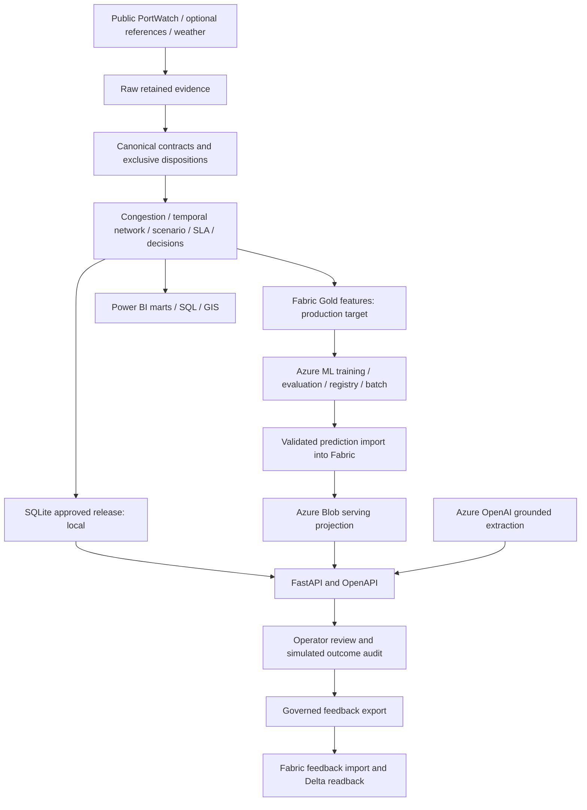

# Actual integration map

Local execution uses Python/pandas, SQLite WAL and disk evidence. Fabric runtime uses PySpark/Delta and executes the bounded graph/scenario engine on the driver (one million activity-row limit). SQLite is driver-temporary in Fabric, never hosted on OneLake. PostgreSQL is not an existing component and is not needed to reproduce this architecture.

Each product row carries classification/run/provenance metadata. Publication is transactional locally; readers verify the approved dataset count/hash. Fabric stage receipts and Delta readback are implemented but not runtime-validated without tenant access.

Azure ML owns the cloud ML lifecycle. Fabric Gold exports observed port-call features; Azure ML handles temporal evaluation, registry promotion and batch inference; the bridge validates compatibility and returns predictions to Fabric. Local Python training is research verification of the retained model logic, not a replacement for Azure ML.

Azure OpenAI is optional for grounded ANTICIPATED extraction. Deterministic decision rationale is available without it. An unavailable AI endpoint raises a service error; no invented signal substitutes for a response.

API storage in Azure is a serving copy of approved Fabric products, with separate audit storage. Entra roles authorize reads/writes; Key Vault and managed identity support secrets. Container Apps and Application Insights are defined in Bicep. No cloud deployment is claimed.

Learning: /learning/export returns checksummed review/outcome records, stable audit IDs, source run IDs and explicit classifications. scripts/fabric_feedback.py exports from AzureStore, uploads to OneLake, executes import_feedback and verifies a content-matched readback receipt. The import produces fact_learning_feedback. Execute one feedback import per source run at a time. Imports merge immutable audit IDs and verify destination content; a partial replay cannot replace previous events. Local SQLite destination transfer is exercised separately. Neither destination permits training on simulated labels.

Interface scope: /docs and authenticated HTTP APIs are the executable local interface. Five PBIR report pages are now authored and schema/field-contract validated. Semantic-model binding, Desktop rendering/filter behavior, refresh and tenant deployment remain unverified. Cloud integrations and production retention remain external acceptance work.
