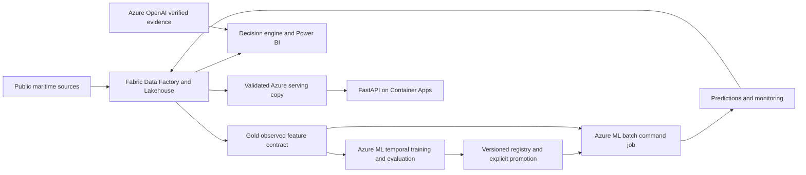

# Fabric and Azure production deployment

Fabric owns ingestion, orchestration, Bronze/Silver/Gold, Spark transformations, data quality,
lineage, maritime state, scenarios, analytical marts and Power BI. Azure ML owns the production
ML lifecycle. Azure OpenAI supplies grounded extraction. Azure Container Apps hosts FastAPI;
Entra validates identities, Key Vault holds optional secrets, and Application Insights collects
telemetry. Azure Blob holds a validated serving copy and operator audits; it is not a second
analytical data pipeline.



## Current execution status

The local implementation, regression tests, real public-data rerun and Docker execution are
measured in `evidence/`. Bicep compilation checks template syntax, not resource provisioning.
No Azure ML job, Fabric notebook, Azure OpenAI request, Entra tenant login, Container Apps
deployment or Power BI refresh has been executed against a customer tenant in this build.
All such runtime acceptance remains environment-dependent.

## Provision the application and ML resources

Prerequisites: an Azure subscription/resource group, deployment rights including role assignment,
quota for the configured AML CPU SKU, an existing Azure OpenAI account/model deployment in that
resource group, and an accessible API container image. Build/publish `docker/Dockerfile` to your
chosen registry and use its immutable digest. A public image works directly; private registry
pull identity/configuration must be supplied before deployment. No extra registry is provisioned.

Register an Entra API application with v2 access tokens, the API audience used below, and app
roles `Maritime.Reader` and `Maritime.Operator`. Assign users/service principals appropriate
roles and request tokens for that API. JWT signatures, issuer, tenant, audience, expiry and
role claims are checked by the API. Operator identity comes from the verified `oid` claim.

```powershell
az login
az deployment group create --resource-group <resource-group> --template-file azure/main.bicep --parameters apiImage=<image-digest> apiAudience=<audience> openAIAccountName=<account> openAIDeployment=<deployment> auditRetentionDays=<owner-approved-days>
uv sync --frozen --no-editable --extra dev --extra azure --extra fabric --extra ml
```

The template provisions AML workspace/CPU compute, storage, Key Vault, monitoring and Container
Apps. API managed identity can read the serving container, write/read the separate audit
container, read Key Vault secrets and invoke Azure OpenAI. Audit writes use unique blob names
and disallow overwrite at application level. The template creates an unlocked retention policy from the required owner-approved duration and a custom API role without delete. Production requires explicit policy locking and effective-permission/overwrite/delete tests; compilation does not prove retention. AML workspace identity has storage
and secret permissions. Give the deployment/job runner the required Azure ML job/data/model
permissions and storage access; the serving publisher needs Blob Data Contributor on
`maritime-serving`. Keep promotion permission in a controlled release identity/environment.

Set the nonsecret IDs in `.env.example` through the shell or CI environment (the application does
not implicitly load `.env`). Prefer managed identity or federated CI login. Never commit keys.
`AZURE_OPENAI_API_KEY` or `AZURE_OPENAI_KEY_SECRET` is optional; absent either, extraction uses
an Azure credential token. The API container uses `entra` and `azure_blob`; local defaults are
`key` and `sqlite`. Invalid mode names fail startup.

## Run the governed feature and prediction cycle

1. Follow `docs/fabric.md` to build/upload the wheel and deploy/execute the Fabric pipeline.
   Its Gold stage uses `ml_backend="azure_ml"`: it exports observed features and does not train.
   Save the accepted Fabric run ID and the deployed `import_predictions` notebook ID.
2. Set `FABRIC_WORKSPACE_ID`, `FABRIC_LAKEHOUSE_ID`, `AZURE_SUBSCRIPTION_ID`,
   `AZURE_RESOURCE_GROUP`, `AZURE_ML_WORKSPACE` and authenticate the runner. The Fabric identity
   needs workspace/item execution and OneLake read/write rights, with tenant service-principal
   access enabled where used. Azure and Fabric permissions are separate.
3. Execute the commands below, substituting actual IDs and registered versions.

```powershell
python scripts/fabric_ml_bridge.py download-features --run-id <fabric-run> --folder data/azure-features
python scripts/azure_ml.py train --data data/azure-features --output data/azure-results
python scripts/azure_ml.py promote --model-version <registered-version> --approver <release-actor>
python scripts/azure_ml.py batch --data data/azure-features --model-version <registered-version> --output data/azure-results
# Use the exact downloaded Azure ML output folder containing predictions.json.
python scripts/fabric_ml_bridge.py upload-predictions --run-id <fabric-run> --folder <prediction-output-folder>
python scripts/fabric_ml_bridge.py publish-serving --run-id <fabric-run> --folder data/serving
```

`fabric/deployment.json` identifies the import notebook, or set
`FABRIC_PREDICTION_NOTEBOOK_ID` explicitly. The bridge waits for the import notebook, then reads
its completion record. The notebook verifies feature/model/run contracts and Delta row counts,
stores PREDICTED results, and attaches port-activity forecasts as supplemental decision evidence.
It never presents those forecasts as shipment SLA probabilities. Publication requires the Fabric
acceptance gate; an uploaded JSON file alone cannot pass it. Use one serving publisher at a time.

Azure ML training reuses the existing persistence/ridge/random-forest experiment, chronological
walk-forward selection, separate calibration and final holdout. MLflow records parameters,
metrics and artifacts. Models enter the registry as candidates, with evaluation eligibility;
promotion requires an explicit pinned version and approver. Batch inference rejects unpromoted
models and incompatible feature/runtime versions. The supplied batch workload is an Azure ML
v2 command job; no online endpoint is needed. Dependencies are resolved from the committed lock.

After later observations arrive, download their accepted feature bundle and run:

```powershell
python scripts/azure_ml.py monitor --data <later-feature-folder> --predictions <prior-predictions.json> --output data/azure-monitoring
```

Batch outputs include standardized feature-mean shifts and alerts. Outcome monitoring measures
MAE/coverage only for matched observed dates; unmatched predictions remain awaiting observations.
These are executable Azure ML monitoring jobs, not a claim that a managed scheduled monitor or
alert subscription has been configured. Schedule the manual workflow in your release process once
tenant acceptance passes. Preserve job IDs, model IDs, manifests and import readback artifacts.

## SLA and evidence boundaries

SLA ML remains **DEFERRED — INSUFFICIENT OBSERVED OUTCOME DATA**. No SLA model is registered or
trained from synthetic outcomes. Synthetic shipment/counterfactual outputs remain SIMULATED.
Real shipment labels require a governed outcome contract, provenance, consent/access controls,
chronological evaluation and an approved training implementation before this gate can change.
Infrastructure can host that future lifecycle; the current runnable model forecasts port calls.

Azure OpenAI extraction requires source-span verification for quote, event, location and time;
unsupported claims are rejected. Accepted unconfirmed signals are ANTICIPATED. OBSERVED,
DERIVED, ANTICIPATED, SIMULATED and PREDICTED remain distinct throughout API and analytical data.

## Runtime acceptance and recovery

Require successful Fabric Delta readback, AML training/evaluation/registration, explicit promotion,
batch inference, prediction return, serving publication, authenticated API checks and Power BI
refresh before declaring cloud E2E passed. Inspect saved job evidence on any nonzero exit. Failed
training is not registered; failed serving publication does not advance the publication pointer.
Keep the prior promoted model and accepted Fabric run for rollback. Redeploy a pinned prior API
image and republish the approved prior serving snapshot when needed.

Microsoft references: [Azure ML command jobs](https://learn.microsoft.com/azure/machine-learning/how-to-train-model?view=azureml-api-2),
[model management](https://learn.microsoft.com/azure/machine-learning/how-to-manage-models?view=azureml-api-2),
[Azure OpenAI v1](https://learn.microsoft.com/azure/ai-foundry/openai/api-version-lifecycle),
[Fabric job scheduler](https://learn.microsoft.com/rest/api/fabric/core/job-scheduler/run-on-demand-item-job).
