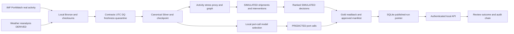

# Integration map — 18 October 2026

Legend: **proven** means a specific retained execution path; **partial** means only part of the chain was executed; **unverified** means no target round-trip evidence. These are not claims that services are currently running. See component IDs in component-status.json. Source hashes still match the October 17 campaign, while the currently selected local environment has separately recorded problems.

## Data and decision lifecycle

The local arrows above have scoped historical evidence: `evidence/local-release-20261017-freshness-01/live/release-validation.json` proves real public acquisition through governed local publication and expected failure handling. `tests.xml` includes `test_retained_public_data_end_to_end_and_model_loading` and `test_full_pipeline_api_override_and_recovery`; these are historical replay/in-process local paths. `docker/maritime-demo-4836fad43b/result.json` proves actual HTTP reads/writes/auth/restart against retained public data with simulated shipments. Do not combine these separate executions into a claim that a live cloud-to-public-dashboard transaction was observed.

PortWatch OBSERVED means received publisher activity estimates, not directly measured waiting/dwell or commercially observed shipment outcomes. Weather remains DERIVED reanalysis. Default routes and shipment outcomes remain SIMULATED. Stress/exposure transforms carry their declared evidence classification; forecasts are PREDICTED. Source acquisition timestamps are not observation dates. WPI/UNLOCODE/route-download arrows are absent because their URLs are unconfigured. WTO/Comtrade has research evidence only, no runtime arrow.

Today’s retained official latest-one probes at 05:35:19–05:35:29Z show all six ports at October 9, age 9 on October 18, with unchanged ten-day checks. They are in `evidence/portfolio-release-20261018-083345/freshness.json`. They did not update local databases or prove a new full run. Default local cached activity still stops October 2.

## Orchestration, failure, checkpoint and audit

`cli.run` → `pipeline.run` → OS lock → Store initialization → stage gates → reports/audits → final publication transaction is **proven locally**, with scope in the retained campaign/tests. Configuration failures are retained, expected bad input and partial persistence block publication, and prior approved products remain stored.

Checkpoint update happens after DQ and before scenario/model/publication success. Thus checkpoint progress and accepted publication are separate states. CLI invocations create new UUIDs; programmatic matching successful run IDs have a separate verified-return path. Interrupted RUNNING attempts can become ABANDONED on the next lock-owning run. Current writer ownership and safe recovery of a chosen target were not tested here. No recurring scheduler is defined by inspected code/workflows; CLI execution and manually triggered cloud deployment are not schedules.

## Forecast, approval and decision output

Local observed activity → lagged features → temporal model comparison/evaluation → versioned local model → predictions → Gold/API is **proven in local research execution**. Model integrity/import contracts are locally tested.

There is **no proven or implemented local forecast → recommendation influence**: `pipeline.py` ranks scenario interventions before generating forecasts, and `scenarios.py` ranking consumes scenario outcomes. Forecasts appear alongside decisions. Do not describe recommendations as driven by forecasts without a new traced and tested dependency. A public-facing claim may instead say both analytical outputs are available.

Cloud intention:

```mermaid
flowchart LR
  FAB[Fabric accepted Gold] -. unverified .-> FEAT[Versioned feature transfer]
  FEAT -. unverified .-> AML[Azure ML train evaluate register]
  AML -. unverified .-> AP[Named approval and version promotion]
  AP -. unverified .-> BAT[Cloud batch predictions]
  BAT -. unverified .-> IMP[Fabric prediction-import notebook]
  IMP -. unverified .-> SERV[Azure Blob serving publication]
  SERV -. unverified .-> CA[Container Apps API with Entra]
```

Local job functions, compatibility, rejection and promotion eligibility tests prove contracts, **not these service edges**. No production model approval was observed. Shipment-SLA ML remains deferred for lack of representative lawful outcomes.

Fabric deployment code builds a four-stage Bronze → Silver → Gold → acceptance DataPipeline and separately deploys import_predictions/import_feedback notebooks: **six notebooks**, not five. Dependencies/polling are implemented and assets tested, but actual Fabric item execution and Delta readback are unverified. The older `fabric/pipelines` inventory path is not where the current definition resides.

Azure audit → feedback export → OneLake packet → Fabric import_feedback → Delta learning mart is **partial**: real local SQLite destination/replay tests passed; actual cross-service transfer remains unverified. Imported feedback is not automatically eligible observed SLA training data.

Azure OpenAI source-text → authenticated service → grounded ANTICIPATED signal → audit is **partial**: controlled request/response, grounding and bounded failure contracts passed; no actual authorized service round trip is established. It is an explicit extraction path rather than an automatic prerequisite of the local full pipeline.

## Reporting and monitoring

Gold JSON/GIS → API is proven locally. Gold → SQL views/Power Query/DAX → semantic model → PBIR rendering → service refresh/RLS is **partial/unverified**: local export and static PBIR schema/column checks exist; semantic-model binding, SQL/DAX/M execution, Desktop rendering, refresh and service access tests do not. `definition.pbir.template` still contains a required-model placeholder. Five report page definitions are present; this is not a deployed dashboard. A separate custom browser dashboard is not implemented; OpenAPI is the local interactive API interface.

Pipeline/API → local reports, metrics and request correlation is **proven locally**. Telemetry configuration → Azure Monitor reception is **unverified**. Monitor metrics → configured alert rule → action group → received notification has **missing implementation/configuration evidence**: no action-group/metric-alert/scheduled-query-rule resources or executed delivery test were found in the inspected template. Monitoring resources alone do not close this chain. Owners and SLOs remain unassigned/unapproved in operations documentation.

## Backup and recovery

Local disposable source → actual backup → checksum verification → fresh restore → audit chain and published-run verification is **proven historically** by `docker/maritime-demo-4836fad43b/backup-restore.json` and `test_actual_backup_restore_and_tamper`. Restore destination conflicts and bad inputs have tests. This is not a verified backup of today's chosen operational root.

Local backup → encrypted offsite storage → loss-of-primary recovery → failover within agreed RPO/RTO is **unverified/not configured**. Database administrators can bypass local protections; cloud retention policy remains unlocked/unaccepted without owner-approved deployment and denial/expiry tests.
