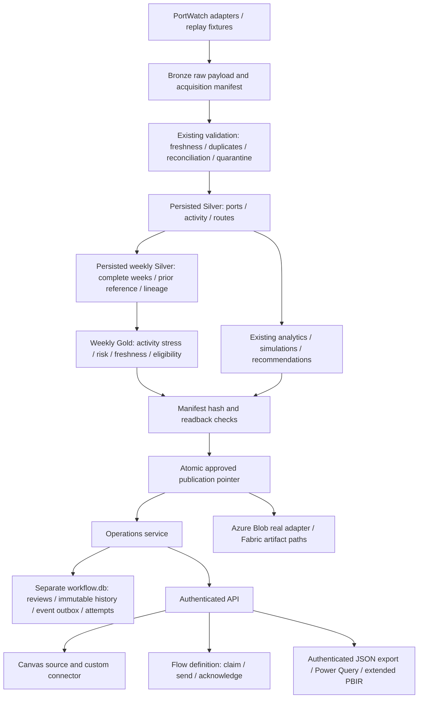

# Implemented medallion and operational workflow

The extension reuses the existing source adapters, canonical validation, SQLite, Python analytical engines, Azure Blob adapter, Fabric adapter and PBIR generator. It introduces no new service or database technology.

## Persistence and lineage

`pipeline.run` validates acquisition/replay data and writes quarantine dispositions. Normalized rows are persisted in `silver_datasets` and run-scoped `silver/<run>/` files, read back, and then consumed by analytics. `medallion.weekly_silver` writes a distinct weekly contract and `weekly_gold` consumes that persisted contract. Weekly Gold is stored in `gold_datasets` and `gold/<run>/operations/port_weeks.json`. Existing core products and historical governance schema remain intact.

`Store.publish` verifies every Silver/Gold manifest hash and row count inside the publication transaction. The approved datasets are immutable through insert/update/delete triggers. Failed or partial writes cannot advance the published pointer. `read_layer` requires approved manifest agreement. AzureStore performs equivalent boundary validation and content-hashed uploads/readback before publication. CLI import, Fabric serving export and recovery verification carry the supplemental medallion contracts.

Source IDs, observation dates, acquisition timestamps, run IDs, input fingerprints, lineage IDs and methodology version travel through the layers. Retrieval time never substitutes for observation time. Existing acquisition/replay distinctions and deduplication/reconciliation checks remain tested. Workflow writes only its own database; it does not change source observations, Gold risk or recommendations.

## Versioned weekly methodology

`port-week-activity-v1` uses Monday-through-Sunday weeks. All seven daily observations are required for a weekly total; missing/partial weeks have a null weekly total and explicit missing dates, never fabricated zeros. A reported zero remains zero. The baseline uses complete weeks within the preceding eight calendar weeks, with at least four complete reference weeks. No future week enters the baseline. The signed deviation is `(weekly_calls - reference_mean) / max(1, population_standard_deviation)`.

Absolute deviation thresholds are centralized in `medallion.py`: ELEVATED >= 1, HIGH >= 2, CRITICAL >= 3. Missing weeks and insufficient history have separate classifications. Both higher and lower activity are derived stress proxies; neither is directly measured vessel waiting/dwell time. All thresholds have boundary tests. Current eligibility requires HIGH/CRITICAL, complete observations, and source observation age between zero and ten days inclusive. Serving recomputes source freshness against current time; historical facts remain available but stale decisions are rejected.

Stable review IDs bind canonical port, week and methodology. Risk revisions bind actual inputs and derived risk; retrieval timestamp changes alone do not create new revisions. Changed risk invalidates prior current action while preserving immutable history. Simulation markers remain visible. Forecasts remain supplemental and do not influence recommendation ranking. No observed commercial shipment-SLA labels or validated commercial SLA capability were added.

## Deployment boundaries

Local SQLite paths are exercised end to end in temporary roots. Azure/notification transports are fakes at the external boundary, not live verification. Fabric code and notebooks retain their actual interfaces; no Spark runtime was started. The single-host durable workflow store requires separate backup/retention and production concurrency acceptance. No persistent user database, checkpoint or service was modified or started.
